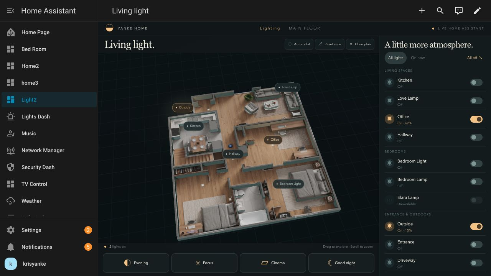

# Light Dashboard

A compact Home Assistant lighting dashboard with an animated Three.js floor-plan relief, live light controls, four lighting presets, and an Outside timer toggle.

The screenshots show the compact layout before the later shared-appearance and Outside timer additions. The JavaScript in this folder includes those newer features.

## Files

- `yanke-light2-card.js`: complete, editable custom-card source, including layout, light mapping, 3D model, and live Home Assistant integration. No build step required.
- `yanke-appearance.js`: shared appearance support; load before the card. It uses existing appearance helpers when available and supplies defaults otherwise.
- `dashboard.json`: panel-view Lovelace configuration.
- `entities.json`: reference list of the ten mapped lighting entities. The actual mapping is the `ENTITIES` constant in the card source; this JSON is not loaded at runtime.
- `assets/Floor-Plan3d.png`: floor-plan texture used by the traced model.
- `screenshots/`: desktop and mobile layout previews.

## Install

1. Copy both JavaScript files into `/config/www/light-dashboard/`.
2. Copy `assets/Floor-Plan3d.png` to `/config/www/FloorPlan/Floor-Plan3d.png`. Preserve this capitalization, or update the texture URL in the card source.
3. In Home Assistant's dashboard resource settings, register these as **JavaScript modules**, in this order:
   - `/local/light-dashboard/yanke-appearance.js?v=1`
   - `/local/light-dashboard/yanke-light2-card.js?v=1`
4. Create or open the Light2 dashboard and use its raw configuration editor to paste the contents of `dashboard.json`. Back up its current configuration before replacing it.
5. Reload the browser. When updating either file, bump the corresponding `?v=` value to refresh cached clients.

If the shared appearance module is already registered elsewhere, use that existing registration instead of adding a duplicate.

## Customize for another home

Edit `ENTITIES` in `yanke-light2-card.js` to point to your actual light and switch entities. Customize the display names, source-image coordinates in `locations`, and the original-dashboard link (`/dashboard-lights/0`) as needed.

The model traces this specific 500 × 538 floor plan. Its floor and furniture surfaces use the original artwork; raised walls and furniture outlines add illustrative depth. Replacing the texture with a different house requires retracing the geometry and light coordinates. Heights are not measured architectural dimensions.

The Outside timer button controls `input_boolean.outside`. It is disabled if that helper is missing or unavailable. The button does not install a motion sensor, timer, or automation; its automatic-dimming behavior depends on existing Home Assistant automations. The displayed description assumes a two-minute return to 15% brightness.

## Controls

- Light switches and model labels operate the mapped entities.
- Light names open Home Assistant's native more-info dialog, including brightness where supported.
- Incoming Home Assistant state updates drive the model and status labels.
- Unavailable entities are disabled and skipped by presets.
- Pending commands wait for state confirmation; errors are shown without pretending a device changed state.
- Opening the dashboard does not operate lights.
- Drag the model to rotate, scroll to zoom, or select Floor plan for an overhead view. Narrow layouts hide map labels and auto-orbit controls to keep the model readable.

### Presets

Each preset turns the listed lights on and the other available mapped lights off. Existing brightness and color settings are preserved.

| Preset | Lights on |
|---|---|
| Evening | Kitchen, Love Lamp, Office, Bedroom Light, Outside |
| Focus | Kitchen, Office, Hallway, Entrance |
| Cinema | Love Lamp, Bedroom Lamp |
| Good night / All off | None |

## Layout and dependencies

The compact layout was checked at 1280 × 720, 390 × 844, and 375 × 667. It uses dynamic viewport height and container queries; very short viewports, larger accessibility text, or different app chrome may require scrolling.

Three.js **0.187.0** loads from jsDelivr on demand. The first 3D load requires internet access; normal HTML lighting controls remain available if the library fails to load. The floor-plan texture is served locally by Home Assistant. No separate preview server or access token is required.

## Validation and rollback

JavaScript syntax was checked with `node --check`. Service routing, state updates, preset handling, unavailable entities, failures, and navigation cleanup were exercised with mocked services. The installed card was also inspected against live Home Assistant states; physical lights were not toggled during those installation checks.

To roll back, restore your saved dashboard configuration. Remove these resource registrations only after no dashboards use them. Manage dashboard configuration through Home Assistant's UI or API; do not edit `.storage` files directly.
